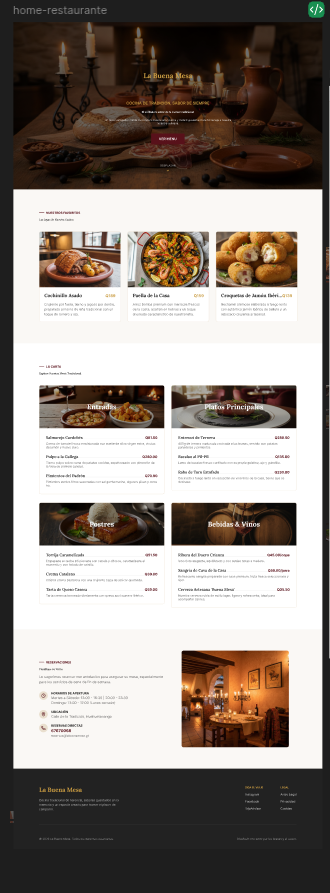
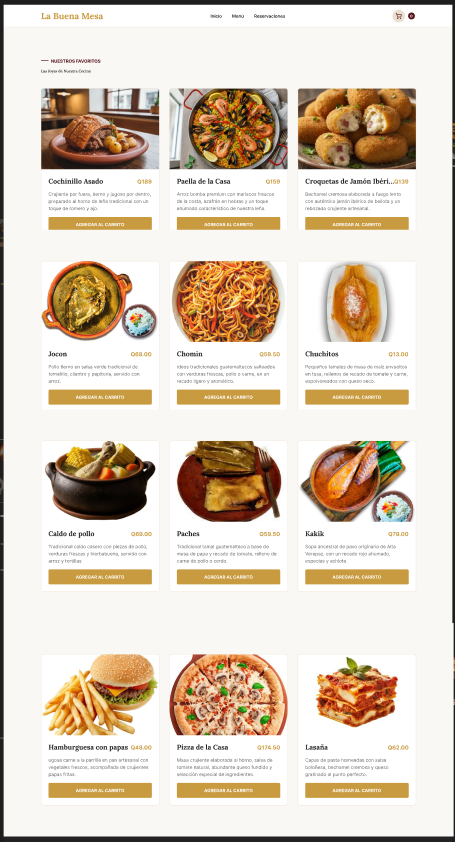
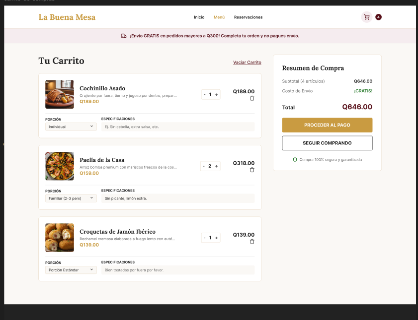
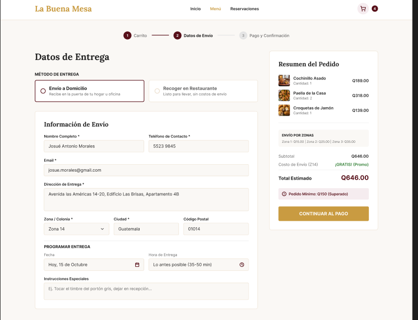
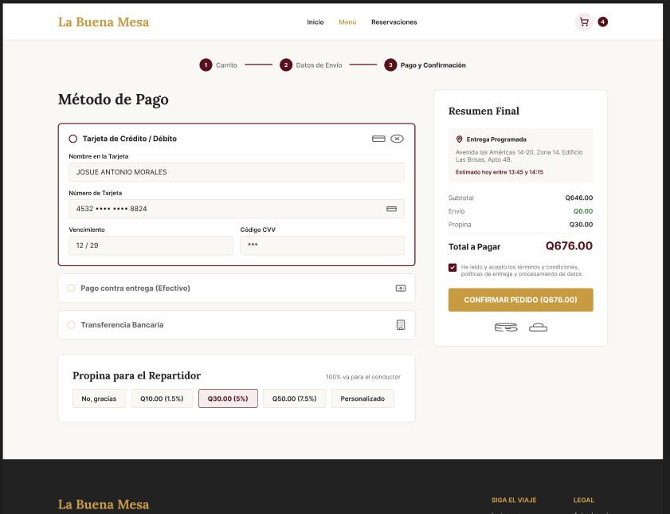

# Planificación inicial del sistema de pedidos

Este documento reúne los bocetos de la primera fase. La implementación final se describe en [la guía del código](CODIGO.md) y en [`schema.sql`](../schema.sql).

## Objetivo y alcance

- **Proyecto:** sistema web de comida a domicilio.
- **Período de planificación:** 31 de agosto al 15 de septiembre de 2026.
- **Objetivo:** definir la interfaz, la navegación y el modelo relacional para registrar pedidos.

Las vistas previstas fueron inicio, menú, carrito, captura de datos de entrega, pago y confirmación. La implementación final también incluye seguimiento de órdenes.

## Diseño de la interfaz

El [diseño original en Figma](https://www.figma.com/design/vBu9SUTUT6xul4ZHcFDUaZ/Restaurante-dise%C3%B1o?node-id=2-4&t=ow19rvHBc5zGFVAK-1) sirvió como referencia para las páginas y componentes del frontend.

| Vista | Boceto |
| --- | --- |
| Inicio |  |
| Menú |  |
| Carrito |  |
| Datos de entrega |  |
| Pago y confirmación |  |

## Base de datos final

El esquema implementado usa `usuarios`, `productos`, `pedidos`, `pedido_entrega`, `detalles_pedido` y `resumen_pedidos`. Sus columnas, claves y productos iniciales están definidos en [`schema.sql`](../schema.sql).
